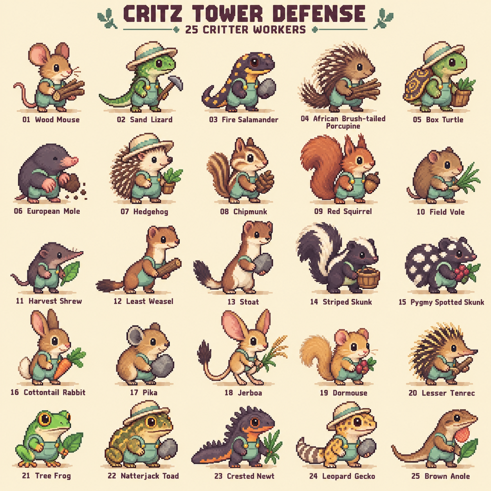

# Critz Tower Defense — 25 critter Workers

Pixel character exploration generated with the built-in imagegen tool on
October 10, 2026. The exact generation prompt is saved in [PROMPT.txt](PROMPT.txt).
One sheet contains 25 unique wild animal species, all naturally smaller than a
honey badger. The porcupine is the small African brush-tailed species.

| # | Critter | Recognition cue |
|---|---|---|
| 1 | Wood mouse | Round ears, thin tail |
| 2 | Sand lizard | Green scales, tapering tail |
| 3 | Fire salamander | Dark body, gold spots |
| 4 | African brush-tailed porcupine | Cream quills, bristly tail |
| 5 | Box turtle | Domed patterned shell |
| 6 | European mole | Broad digging paws, pink snout |
| 7 | Hedgehog | Rounded spine mantle |
| 8 | Chipmunk | Facial and back stripes |
| 9 | Red squirrel | Large curled tail, ear tufts |
| 10 | Field vole | Small ears, stubby body |
| 11 | Shrew | Long pointed snout; sheet uses the creative label “Harvest Shrew” |
| 12 | Least weasel | Slender cinnamon body, cream throat |
| 13 | Stoat | Black-tipped tail |
| 14 | Striped skunk | Bold cream stripe |
| 15 | Pygmy spotted skunk | Broken cream spots |
| 16 | Cottontail rabbit | Long ears, cotton tail |
| 17 | Pika | Round ears, no visible tail |
| 18 | Jerboa | Huge hind feet, tufted tail |
| 19 | Dormouse | Golden coat, fluffy tail |
| 20 | Lesser tenrec | Pointed snout, narrow spine crest |
| 21 | Tree frog | Sticky toe pads, large eyes |
| 22 | Natterjack toad | Stocky body, gold dorsal stripe |
| 23 | Crested newt | Jagged crest, coral belly |
| 24 | Leopard gecko | Spotted skin, fat tail |
| 25 | Brown anole | Slender silhouette, coral throat fan |

## Visual review

Applied [art bible](../../ART-BIBLE.md) sections **1 (identity)**, **3 (pixel
grammar and scale)**, **4 (palette)**, **6 (Workers)**, and **8 / Scenic biomes
and wildlife**. Compared with the approved Buttonwood reference, the native
Worker walk sprite, and the native animals/cages QA sheet. Cream hats, mint
workwear, gold buttons, warm contours, planted feet, and species-specific
silhouettes carry the family into animal characters.

Review: the sheet has five rows of five individually labeled characters, no
repeated species, readable full bodies, and the exact new game title. It is an
enlarged generated concept, with finer texture than current native sprites;
palette membership and a true native pixel grid are not certified. The native
pass must simplify clusters, differentiate similar mustelids and spiny mammals,
keep tools and tails inside the 40 × 32 canvas, preserve `(18,31)` ground anchors,
and separately draw 32 × 32 portraits. Never shrink this sheet into game assets.

Existing human Workers and live wildlife remain in gameplay. Original wildlife
is preserved in [the archive](../../archive/wildlife-2026-10-10/README.md).

## Clothing comparison — revision 2

The original cast was liked, but the front-only garments looked like aprons.
Two edits of the original sheet compare the clothing direction:

- [A / Full overalls](critz-workers-25-overalls-v2.png): complete mint trousers,
  rear seats, visible side/back pockets, cuffs, and connected shoulder straps.
- [B / No overalls](critz-workers-25-no-overalls-v2.png): natural animal coats,
  scales, and skin, with hats removed and held resources/tools retained.

Generated with the built-in imagegen tool. Exact prompts are retained in
[PROMPT-overalls-v2.txt](PROMPT-overalls-v2.txt) and
[PROMPT-no-overalls-v2.txt](PROMPT-no-overalls-v2.txt). The original sheet remains
preserved. Neither clothing direction is selected for production yet.

Review references: art bible sections **1 (identity)**, **3 (pixel grammar)**,
**4 (palette)**, **6 (Workers)**, and **Clothing comparison revision**; native art
guide **Identity** and **Pixel scale and canvases**. Compared with the approved
Buttonwood reference, native Worker sprite, and original critter concept.

The full-overalls sheet retains the 25-species roster and shows covered rear
hips and two trouser legs, particularly clearer on weasel, stoat, jerboa, and
reptiles. Shells, tails, and spines remain visible. A dedicated rear-view native
study is still needed to establish hidden strap routing before animation.

The clothing-free sheet retains all 25 labeled species, tools, poses, and natural
markings, with no remaining hats, bibs, straps, fasteners, or trousers visible.
Both sheets preserve the 5 × 5 ordering for direct comparison. Generated concept
pixels remain unsuitable for direct downsampling into production sprites.
